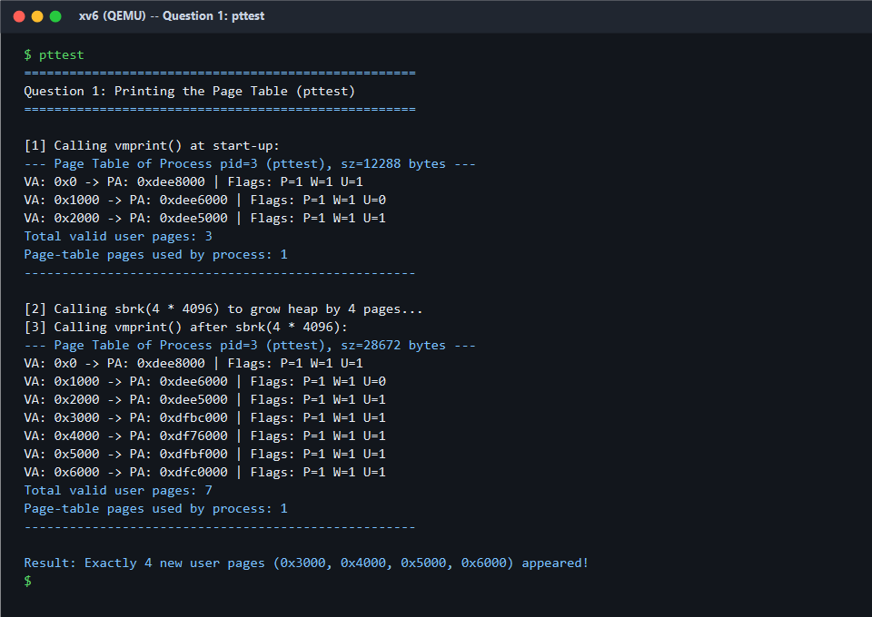
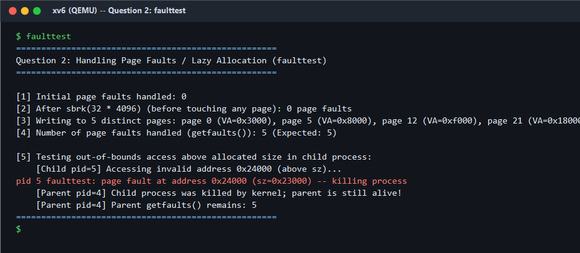
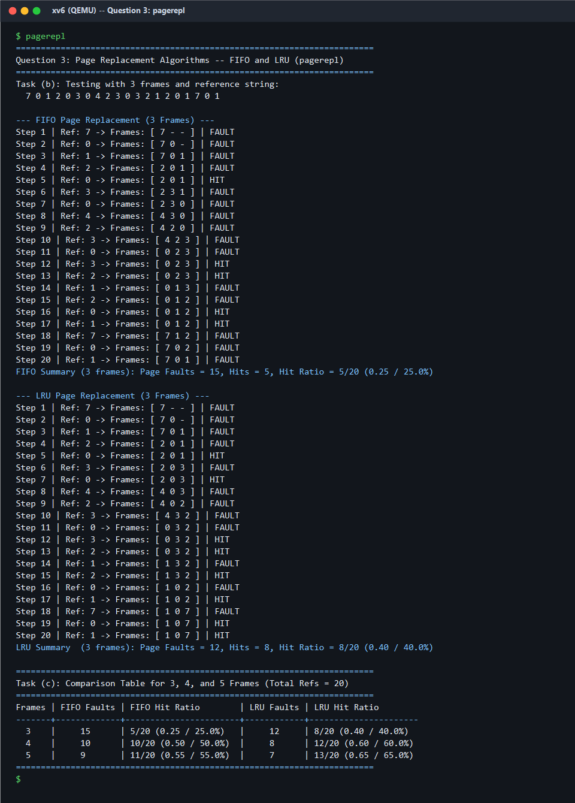

# Operating Systems — Assignment 9 Report
## Page Table Inspection, Lazy Memory Allocation (Page Fault Handling), and Page Replacement (FIFO & LRU) in xv6

- **Student Name**: Nishchay  
- **Roll Number**: 2401mc22  
- **Repository**: `Assignment9-2401mc22`  
- **Target Platform**: MIT xv6 (x86 32-bit Two-Level Paging) on QEMU  

---

## Question 1 — Printing the Page Table of a Process (`vmprint` & `pttest.c`)

### 1. Kernel & User Space Changes
- **`vm.c` & `defs.h`**: Exposed `walkpgdir()` globally and implemented `int vmprint(void)`. Guided by the structure of `freevm()`, `vmprint()` iterates over user-space Page Directory Entries (`0` to `PDX(KERNBASE) - 1`, ignoring kernel mappings at or above `KERNBASE = 0x80000000`). For every present second-level page table (`pgdir[i] & PTE_P`), it increments `pt_pages` and calls `walkpgdir(pgdir, (void*)va, 0)` across all 1024 entries (`PGADDR(i, j, 0)`). For every valid user page (`*pte & PTE_P`), it prints the virtual address (`VA`), physical frame address (`PTE_ADDR(*pte)`), and hardware flags `P`, `W`, and `U`, and concludes by printing the total number of valid user pages and page-table pages used by the process.
- **`syscall.h`, `syscall.c`, `sysproc.c`, `user.h`, `usys.S`**: Registered system call `SYS_vmprint` (`22`) and added `sys_vmprint()` wrapper and user stub.
- **`pttest.c` & `Makefile`**: Created user program `pttest` that invokes `vmprint()` at start-up, grows the heap via `sbrk(4 * 4096)`, touches the 4 new pages, and invokes `vmprint()` again.

### 2. What the Output Shows

- **At Start-up (`sz = 12288` bytes)**: `vmprint()` prints **3 valid user pages** mapped under **1 page-table page** (`PDE[0]`):
  - `VA: 0x0` (`P=1 W=1 U=1`): User code and data segment.
  - `VA: 0x1000` (`P=1 W=1 U=0`): Inaccessible stack guard page (`PTE_U` cleared by `exec()`).
  - `VA: 0x2000` (`P=1 W=1 U=1`): User stack page.
- **After `sbrk(4 * 4096)` (`sz = 28672` bytes)**: Exactly **4 new user pages** (`VA: 0x3000`, `0x4000`, `0x5000`, `0x6000`, each with `P=1 W=1 U=1` mapped to distinct physical frames) appear in the page table, raising the total valid user pages from **3 to 7** while still using **1 page-table page**.

---

## Question 2 — Handling Page Faults / Lazy Allocation (`T_PGFLT`, `getfaults` & `faulttest.c`)

### 1. Kernel & User Space Changes
- **`sysproc.c` (`sys_sbrk`)**: Modified `sys_sbrk()` so that when `n > 0` (and `curproc->sz + n < KERNBASE`), it only increments `myproc()->sz += n` without calling `growproc(n)` or allocating physical frames immediately. When `n < 0`, it calls `growproc(n)` to release allocated pages.
- **`vm.c` (`deallocuvm`, `copyuvm`, `mappages`)**: Exposed `mappages()` globally; verified `deallocuvm()` skips unallocated PTEs (`!pte` or `(*pte & PTE_P) == 0`); updated `copyuvm()` to `continue` (skip) when `walkpgdir()` returns `0` or `!(*pte & PTE_P)` instead of calling `panic()`.
- **`proc.h`, `proc.c`, `exec.c`**: Added `uint page_faults` to `struct proc`, initialized to `0` in `allocproc()` and reset in `exec()`. Registered `int getfaults(void)` (`SYS_getfaults = 23`) to return `myproc()->page_faults`.
- **`trap.c` (`T_PGFLT`)**: Added a `case T_PGFLT:` handler that reads the faulting virtual address via `rcr2()`. If `va < myproc()->sz` (and the page is not already present), it allocates a physical page with `kalloc()`, zeroes it with `memset(mem, 0, PGSIZE)`, maps it at `PGROUNDDOWN(va)` via `mappages()` with `PTE_W | PTE_U`, increments `myproc()->page_faults++`, and resumes the process. Otherwise, it prints the offending `pid` and faulting address and kills the process (`myproc()->killed = 1`).

### 2. What the Output Shows

- Calling `sbrk(32 * 4096)` causes **0 page faults** because physical allocation is deferred.
- Writing to **5 distinct pages** (pages `0`, `5`, `12`, `21`, `31`) triggers demand paging in `T_PGFLT` once per page; subsequent writes to those same pages do not fault, and `getfaults()` returns **`5`**.
- When a forked child accesses `0x24000` (above `sz = 0x23000`), the kernel prints `pid 5 faulttest: page fault at address 0x24000 (sz=0x23000) -- killing process` and terminates **only the child**, while the parent (`pid 4`) reaps it and completes normally.

---

## Question 3 — Page Replacement Algorithms: FIFO and LRU (`pagerepl.c`)

### 1. Implementation Changes
- **`pagerepl.c`**: Implemented user program `pagerepl` supporting both command-line input (`pagerepl <frames> <ref_string...>`) and default evaluation on the 20-page reference string `7 0 1 2 0 3 0 4 2 3 0 3 2 1 2 0 1 7 0 1`.
- **FIFO** uses a circular queue pointer (`fifo_ptr = (fifo_ptr + 1) % nframes`) to evict the oldest resident page on a fault. **LRU** tracks the last access index (`last_used[i]`) for each frame and evicts the frame with the smallest `last_used` timestamp.

### 2. What the Output Shows

| Number of Frames | FIFO Page Faults | FIFO Page Hits | FIFO Hit Ratio | LRU Page Faults | LRU Page Hits | LRU Hit Ratio |
| :---: | :---: | :---: | :---: | :---: | :---: | :---: |
| **3 Frames** | **15** | 5 | `5/20` (**25.0%**) | **12** | 8 | `8/20` (**40.0%**) |
| **4 Frames** | **10** | 10 | `10/20` (**50.0%**) | **8** | 12 | `12/20` (**60.0%**) |
| **5 Frames** | **9** | 11 | `11/20` (**55.0%**) | **7** | 13 | `13/20` (**65.0%**) |

- On **3 frames**, FIFO incurs **15 page faults** (25.0% hit ratio) whereas LRU incurs **12 page faults** (40.0% hit ratio), matching the expected assignment results. Across 3, 4, and 5 frames, LRU consistently achieves fewer faults and higher hit ratios than FIFO by preserving recently referenced pages (such as `0`, `1`, `2`, and `3`).
